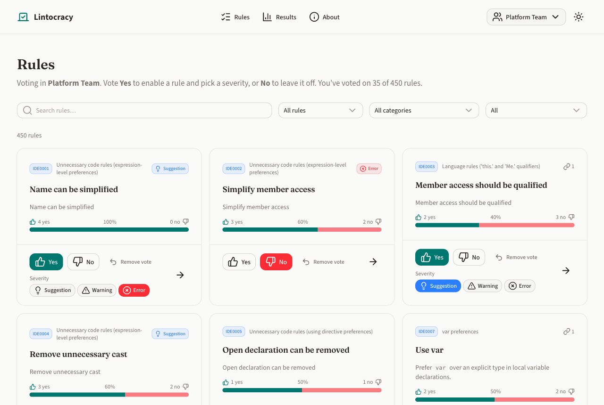
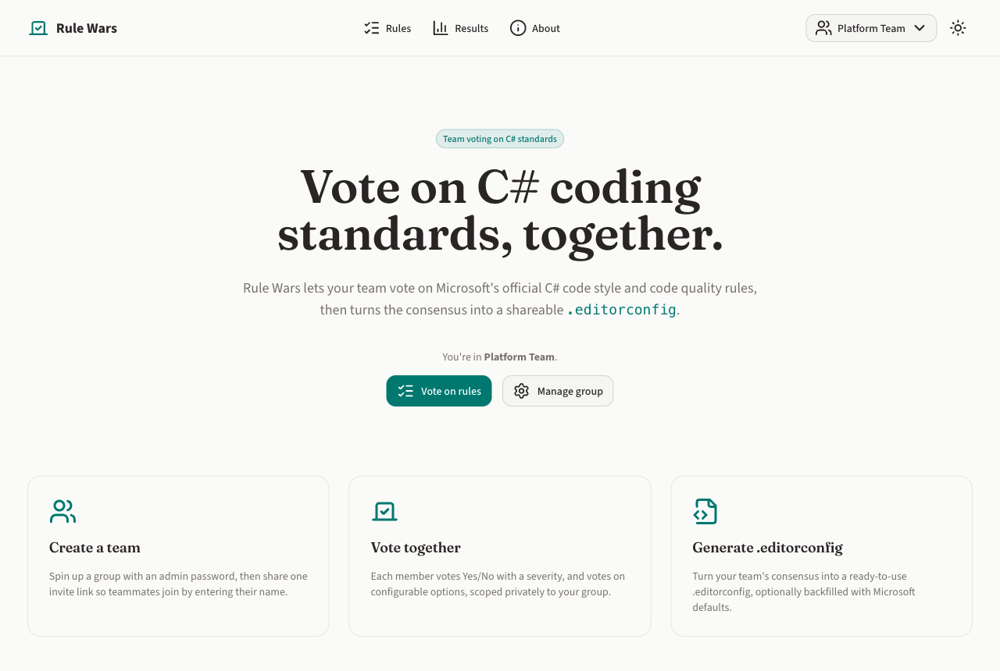
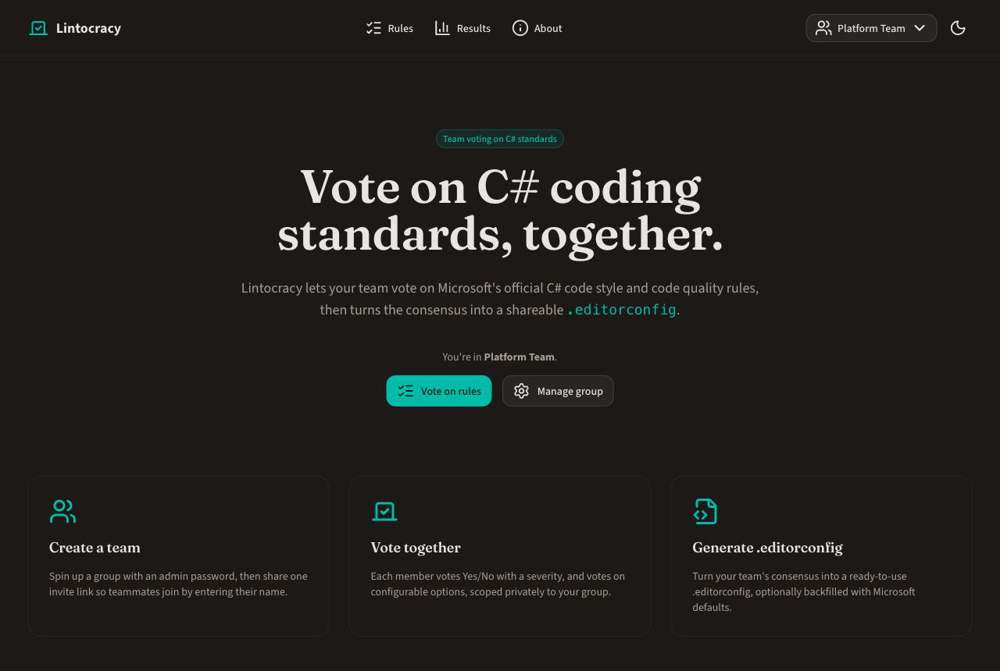
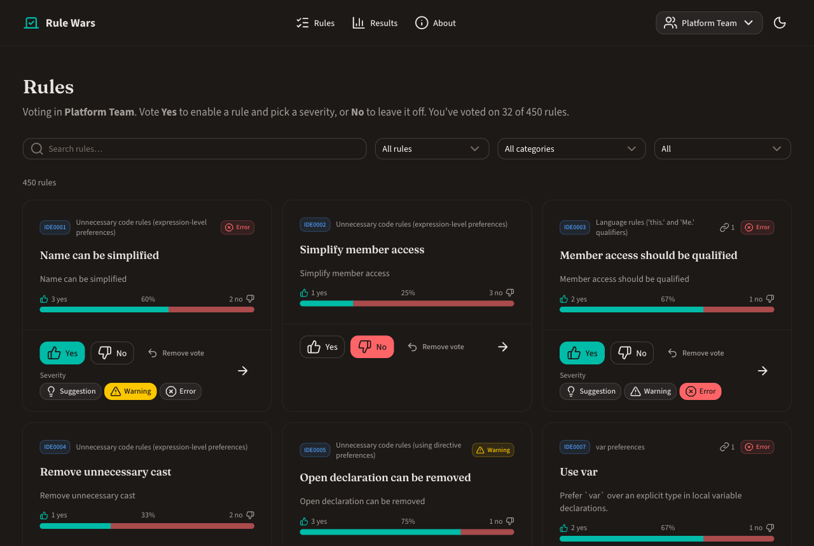
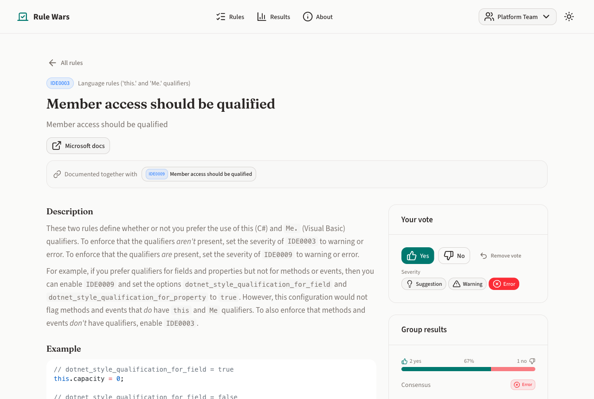
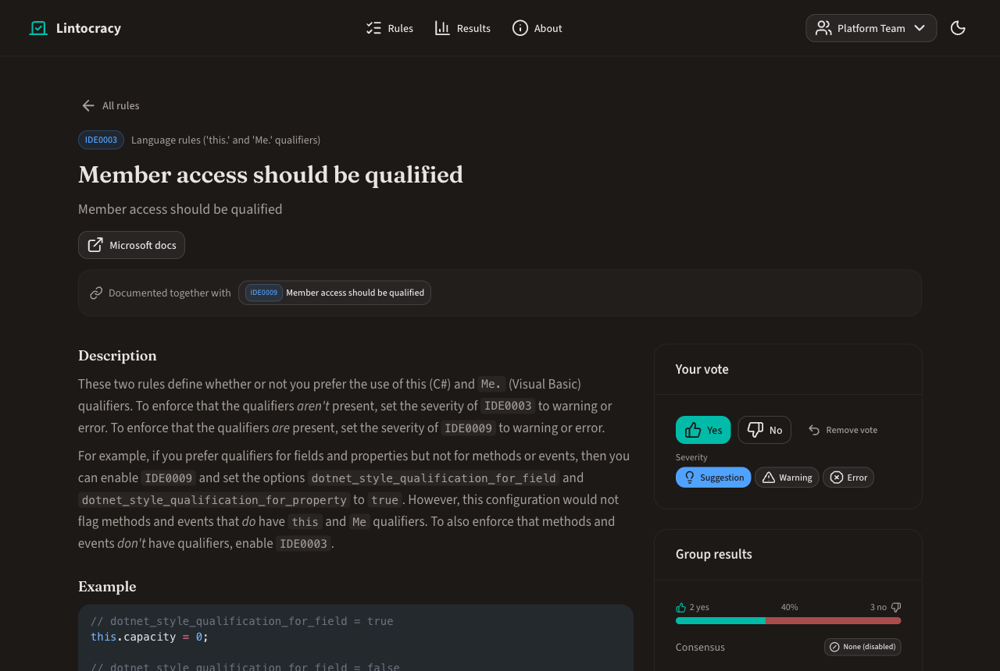
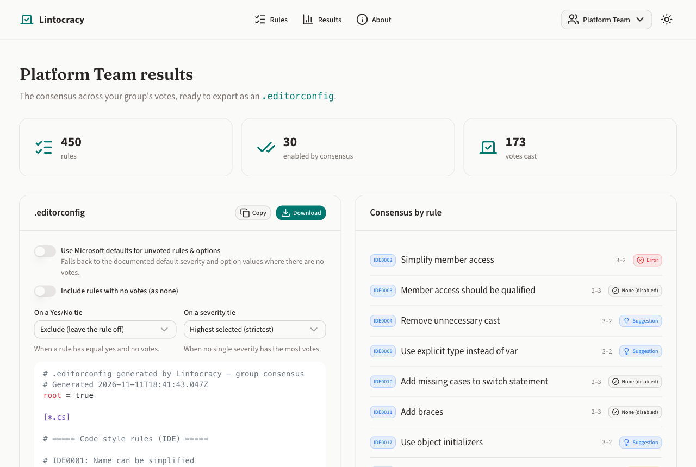
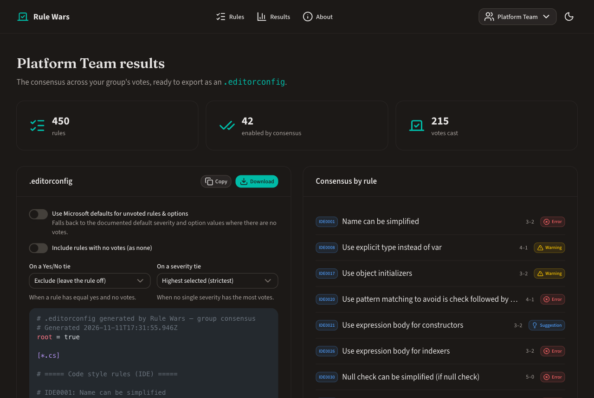
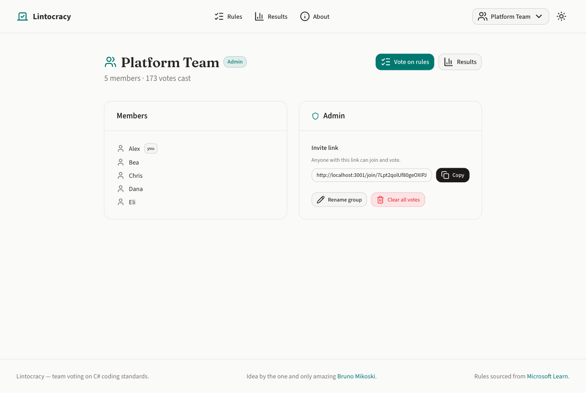
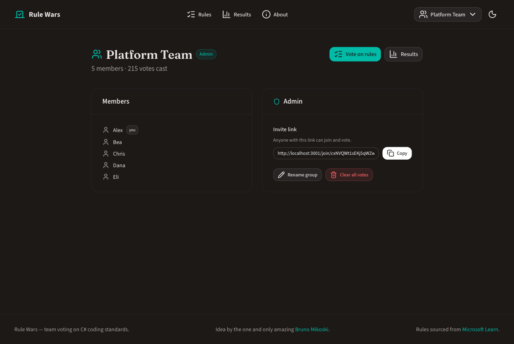

# Lintocracy

Group voting on C# coding standards. Create a group, invite your teammates, browse Microsoft's official C# **code style**
(`IDExxxx`) and **code quality** (`CAxxxx`) analyzer rules, vote on each, and generate a
consensus `.editorconfig` you can drop into any C# project.

<picture>
  <source media="(prefers-color-scheme: dark)" srcset="docs/screenshots/rules-dark.png">
  
</picture>

- **Vote Yes** to enable a rule and choose a severity (`suggestion` / `warning` / `error`).
- **Vote No** to leave a rule off (maps to `none`).
- **Vote on options**: for rules with configurable `.editorconfig` options, pick the value you prefer.
  Options that take any value (such as IDE0036's modifier order) let you type one, or join a value someone else typed.
- **Change your mind**: click your current choice again, or use *Remove vote*, to withdraw a vote.
- Your group's votes aggregate into a generated `.editorconfig`:
  majority Yes enables a rule, the most-voted severity wins, and the most-voted value wins for each option.
  You choose how ties are broken, and can fill unvoted rules with Microsoft's documented defaults.

Each group is private — votes, results, and the generated `.editorconfig` are scoped to the group. One ballot per browser per group.

## Screenshots

| Light | Dark |
| --- | --- |
|  |  |
| **Home** — start or join a group | |
|  |  |
| **Rules** — search, filter and vote on every rule | |
|  |  |
| **Rule detail** — description, examples, options and the group's tally | |
|  |  |
| **Results** — consensus per rule and the generated `.editorconfig` | |
|  |  |
| **Group** — members, invite link and admin tools | |

## Tech stack

- [Nuxt 4](https://nuxt.com) (Vue 3, SSR) + [Nuxt UI](https://ui.nuxt.com)
- [Drizzle ORM](https://orm.drizzle.team) + libSQL/SQLite (`@libsql/client`)
- [Shiki](https://shiki.style) for C# example highlighting
- [Zod](https://zod.dev) for request + dataset validation

## Project structure

```
app/                    # Nuxt app
  assets/css/main.css   # Tailwind + Nuxt UI imports and the Editorial theme (fonts, colours, headings)
  components/           # RuleCard, VoteControl, OptionVoteControl, RuleProse, CodeBlock, TallyBar, SeverityBadge
  composables/          # useGroup (active/joined groups), useVoting (shared state + optimistic updates), useHighlighter
  pages/                # index, rules, rules/[id], results, about, groups/new, join/[token], g/[groupId]
  utils/                # prose rendering, severity labels/colours/icons
server/
  api/rules/            # GET /api/rules, GET /api/rules/:id
  api/groups/           # create, join by invite, admin unlock, rename, clear votes, members
  api/votes/            # GET summary, GET me, POST (cast/update), DELETE (remove a vote)
  api/option-votes/     # same as votes, for configurable option values
  api/editorconfig.get  # generated .editorconfig
  data/rules.ts         # merges the full catalog with curated overrides
  data/rules.generated.json  # full CA + IDE catalog (auto-generated)
  data/curated.ts       # hand-curated rules (rich descriptions + examples)
  db/                   # Drizzle schema + connection (schema is created on startup)
  utils/                # group/membership cookies, admin passwords, tallies
  tests/                # API tests: real route handlers on a temporary SQLite file
shared/
  constants/app.ts      # app name and default tab title
  constants/database.ts # SQLite file location
  types/                # shared types (Rule, Severity, RuleTally, groups, ...)
  utils/consensus.ts    # vote -> consensus computation (incl. tie-breaking)
  utils/editorconfig.ts # consensus -> .editorconfig text
scripts/                # rules:generate and rules:enrich (see below)
```

The dataset combines two sources, validated with Zod on server startup:

- **`rules.generated.json`** — the full Microsoft catalog (every `CA` and `IDE` rule),
  generated from the official Microsoft Learn rule index pages via
  `npm run rules:generate`.
- **`curated.ts`** — hand-curated rules with rich descriptions, rationale, C# examples,
  and preferred `.editorconfig` option values. These override the generated entries by id.

Imported rules are further **enriched** from the individual Microsoft docs pages
(overview/description, cause, how-to-fix, when-to-suppress, configurable option tables,
and all C# examples) by `scripts/enrich-rules.mjs`, which reads a local clone of the docs.

To refresh the catalog from Microsoft's docs:

```bash
# 1. List of rules (ids/titles/categories) from the docs index pages
npm run rules:generate

# 2. Enrich each rule from a local clone of the docs at ./code-analysis
#    (clone github.com/dotnet/docs -> docs/fundamentals/code-analysis into ./code-analysis)
npm run rules:enrich
```

## Setup

```bash
npm install
```

Optionally copy the env example. The defaults work out of the box for local development:

```bash
cp .env.example .env
```

## Development

```bash
npm run dev
```

App runs on `http://localhost:3000`. The SQLite database lives at `.data/lintocracy.db`;
its schema is created automatically on first run.

Run the tests with `npm test`. Every pull request and push to `main` runs the tests and
the build (`.github/workflows/ci.yml`).

## Production

```bash
npm run build
node .output/server/index.mjs   # or: npm run preview
```

Set `NUXT_ADMIN_SECRET` to a long random value — it signs the group admin cookies. The
database is the SQLite file at `.data/lintocracy.db`, so keep that directory on persistent storage.

### Docker

Every push to `main` or a `v*` tag builds and publishes a Docker image
(`.github/workflows/docker.yml`); you can also run the workflow by hand from the Actions tab.
`docker-compose.yml` runs it with the database on a named volume:

```bash
ADMIN_SECRET=<long-random-string> docker compose up -d
```

Compose passes `ADMIN_SECRET` to the app as `NUXT_ADMIN_SECRET`. Set `PORT` to serve on a
port other than 3000. To build the image yourself instead: `docker build -t lintocracy .`

### Upgrading from Rule Wars

Lintocracy used to be called Rule Wars, and stored its database at `.data/rule-wars.db`.

- **Local installs** need nothing: on startup the app renames `.data/rule-wars.db` (and its
  `-wal`, `-shm` and `-journal` files) to `.data/lintocracy.db`, unless `lintocracy.db` already
  exists, in which case the old file is left alone.
- **Docker**: the image is now `tnrd/lintocracy` and the Compose volume is `lintocracy-data`.
  A new volume starts empty, so copy the old one into it once, before the app first starts:

  ```bash
  docker compose down        # stop the old container
  docker compose create      # pull the new image and create the new volume, without starting it
  docker volume ls           # Compose prefixes volume names with the project name
  docker run --rm -v <project>_rule-wars-data:/from -v <project>_lintocracy-data:/to alpine cp -a /from/. /to/
  ADMIN_SECRET=<same-secret-as-before> docker compose up -d
  ```

  The project name is the directory holding `docker-compose.yml`, unless you set one. On
  startup the app renames the database file inside the volume. If the new container already
  ran before the copy, it created an empty `lintocracy.db` that wins over the copied
  `rule-wars.db`: stop it, delete that empty `lintocracy.db` from the new volume, and start it again.
  Remove the old volume once you have checked your groups are there.

## API

All voting is scoped to a **group**. Create a group (you become its admin via a
password), share the invite link, and teammates join by entering their name. Votes,
results, and the generated `.editorconfig` are private to each group.

| Method | Route | Description |
| ------ | ----- | ----------- |
| GET | `/api/rules` | All rules in the dataset |
| GET | `/api/rules/:id` | A single rule |
| POST | `/api/groups` | Create a group `{ name, displayName, password }` (creator becomes admin) |
| GET | `/api/groups/:id` | Group context (name, member count, my membership, `isAdmin`) |
| GET | `/api/groups/by-invite/:token` | Public group info for the join screen |
| POST | `/api/groups/by-invite/:token/join` | Join a group `{ name }` |
| POST | `/api/groups/:id/admin` | Unlock admin with the group `{ password }` |
| PATCH | `/api/groups/:id` | Rename the group (admin) `{ name }` |
| DELETE | `/api/groups/:id/votes` | Clear the group's votes (admin) |
| GET | `/api/groups/:id/members` | Group roster |
| GET | `/api/votes/summary?groupId=` | Per-rule tallies + consensus for a group |
| GET | `/api/votes/me?groupId=` | The current member's votes |
| POST | `/api/votes` | Cast/update a vote `{ groupId, ruleId, vote, severity? }` |
| DELETE | `/api/votes` | Remove your vote `{ groupId, ruleId }` |
| GET | `/api/option-votes/summary?groupId=` | Per-option tallies for a group |
| GET | `/api/option-votes/me?groupId=` | The current member's option votes |
| POST | `/api/option-votes` | Cast/update an option vote `{ groupId, ruleId, optionName, value }` |
| DELETE | `/api/option-votes` | Remove your option vote `{ groupId, ruleId, optionName }` |
| GET | `/api/editorconfig?groupId=` | Generated `.editorconfig` (see below) |

`/api/editorconfig` query options:

- `download=true` — serve as an `.editorconfig` attachment
- `includeUnvoted=true` — list rules nobody voted on, as `none`
- `useMsDefaults=true` — fill unvoted rules and options with Microsoft's documented defaults
- `yesNoTie=include|exclude` — enable or skip a rule with equal Yes and No votes (default `exclude`)
- `severityTie=highest|lowest` — pick the strictest or mildest severity on a tie (default `highest`)
